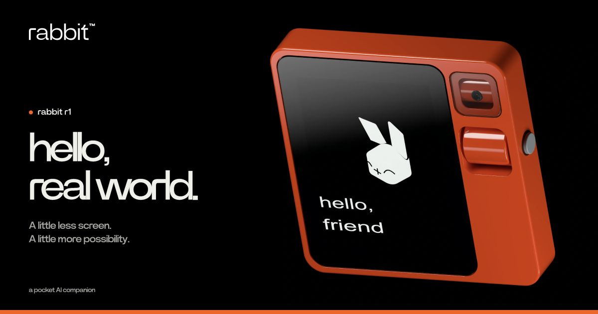

# rabbit r1 — product study

Case de estudo independente por [Gilberto Prado](https://www.instagram.com/gilbertoprado.design/): modelagem no Blender, materiais, renders, vídeo e uma página de produto com interação 3D.

[**Ver a página publicada →**](https://rabbit-r1-product-study.insany-team-1573.chatgpt.site/)



## O que está incluído

- Código da página e versão estática pronta em `dist/`.
- Modelo GLB usado na experiência interativa, imagens, vídeo e arquivos de identidade da página.
- Três arquivos editáveis do Blender: produto-base, closes dramáticos e composição final.
- Seis renders finais em PNG RGB de 16 bits, na resolução original de 3K.

## Rodar localmente

Requer Node.js e npm.

```sh
npm ci
npm run build
npm run dev
```

Abra [http://localhost:4178](http://localhost:4178). Para usar outra porta:

```sh
PORT=4180 npm run dev
```

O build gera `dist/js/main.js`. O HTML e os estilos ficam em `dist/index.html` e `dist/style.css`. A pasta `dist/` pode ser servida por uma hospedagem estática com raiz no domínio.

## Experiência

- Vídeo de abertura que diminui com o scroll e se encaixa entre “hello,” e “world.” antes de liberar a próxima seção.
- Menu em largura total no topo que vira uma barra flutuante ao rolar.
- Três aparelhos frontais que se abrem em leque.
- Seção rabbit OS3 com exemplos interativos ilustrativos.
- Produto 3D que gira com scroll, arraste ou teclado e identifica componentes por interação.
- Tela alternável, três cards de detalhes e composição final com iluminação dramática.
- Layout responsivo, tratamento de movimento reduzido e imagem alternativa quando WebGL não está disponível.

A demonstração de OS3 usa exemplos prontos: ela não grava áudio nem se conecta a um serviço de IA. Os links de compra abrem a página oficial da rabbit.

## Estrutura

```text
src/                 Interações da página, demonstração OS3 e viewer Three.js
dist/                Página e assets servidos ao navegador
scripts/             Build e servidor local
blender/             Fontes editáveis do produto e das cenas
renders/             Seis PNGs finais em 3K e manifesto de integridade
docs/ASSETS.md       Créditos, versões e limites dos materiais
```

## Blender e renders

| Arquivo | Conteúdo |
| --- | --- |
| `blender/rabbit_r1_base_v27.blend` | Produto-base e cenas de apresentação |
| `blender/rabbit_r1_closes_v28.blend` | Closes da grade de som, controles e câmera |
| `blender/rabbit_r1_web_finale_v29.blend` | Composição escura usada no final da página |

As cenas foram produzidas no Blender **5.3.0 Beta**, build `a6f145b151fa`, com GPT-6 operando o Blender via MCP. Ao renderizar novamente, escolha a pasta de saída desejada no Blender.

| Render | Resolução |
| --- | --- |
| `renders/01_frente_3k.png` | 3072 × 3072 |
| `renders/02_costas_3k.png` | 3072 × 3072 |
| `renders/03_close_grade_som_3k.png` | 3072 × 3072 |
| `renders/04_close_controles_3k.png` | 3072 × 3072 |
| `renders/05_close_camera_3k.png` | 3072 × 3072 |
| `renders/06_composicao_dramatica_3k.png` | 3072 × 1728 |

Os arquivos são os masters originais, sem redução de resolução. `renders/manifest.json` registra tamanho e SHA256 de cada imagem.

## Tecnologia

- Three.js 0.180.0
- GSAP 3.14.2 / ScrollTrigger
- esbuild 0.25.10
- GLB com compressão Draco
- HTML, CSS e JavaScript

O modelo usado no navegador preserva a geometria avaliada do Blender. Materiais de brilho e vidro foram adaptados para renderização em tempo real; o resultado WebGL não é apresentado como idêntico ao render Cycles. A tela colorida é uma arte ilustrativa.

## Créditos

Estudo e implementação: **Gilberto Prado**. Produto original: **rabbit × teenage engineering**. Identidade, marca, fontes e selo iF: seus respectivos titulares. Os assets 3D do estudo foram produzidos para esta reconstrução; a identidade oficial não é apresentada como criação original do case.

Este projeto não é afiliado à rabbit e não concede licença sobre marcas ou assets de terceiros. Consulte [os créditos dos assets](docs/ASSETS.md).
